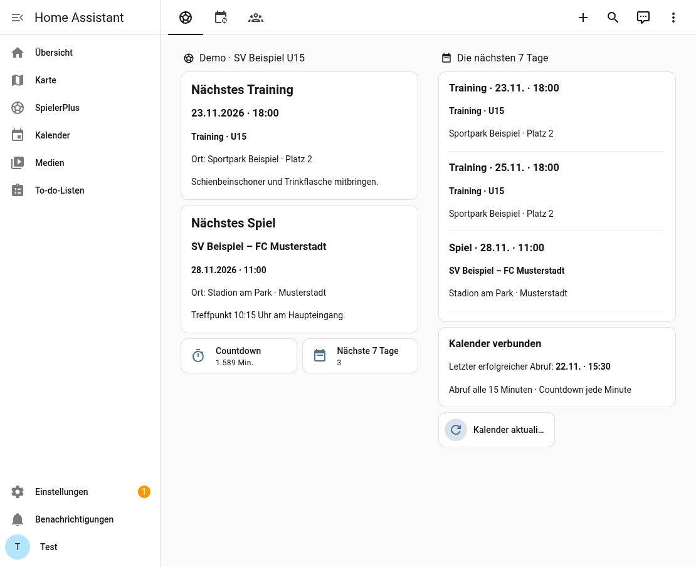
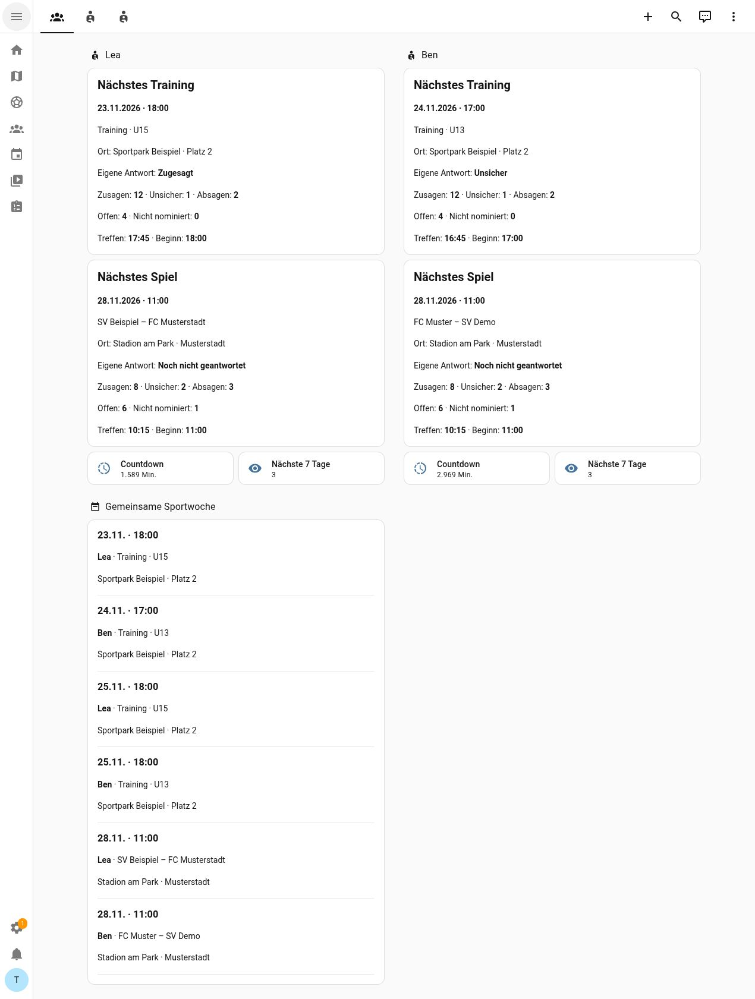
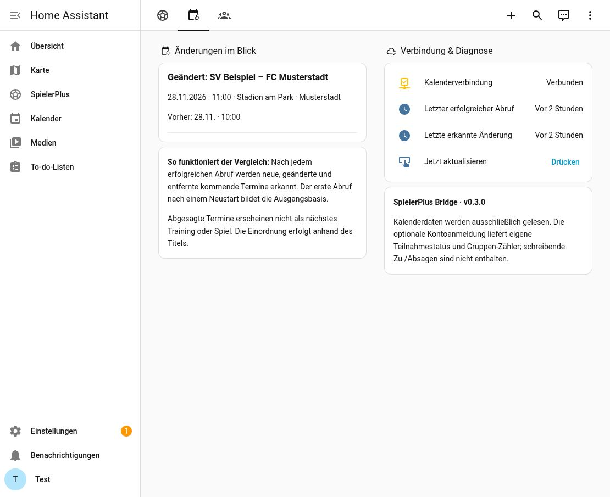
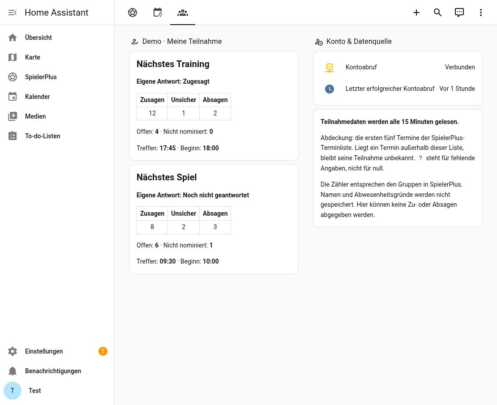
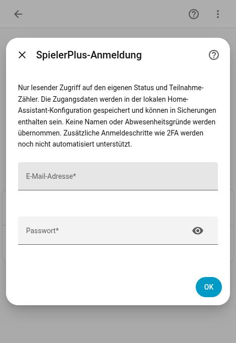

# SpielerPlus Bridge für Home Assistant

[](https://github.com/FabusMingAI/spielerplus-bridge/actions/workflows/ci.yml)
[](https://github.com/hacs/integration)
[](docs/releases/v0.3.0.md)
[](LICENSE)

[English](README.md) · **Deutsch**

Nächstes Training, nächstes Spiel und die Sportwoche in Home Assistant. **SpielerPlus Bridge** liest dein privates SpielerPlus-Kalenderabonnement und macht daraus Entitäten für Dashboards und Automationen – mit einem gemeinsamen Abruf pro Team.

<p></p>

> **Vorschau auf v0.3.0.** Auf einer getrennten Home-Assistant-2026.10.1-Testinstanz auf Raspberry Pi / aarch64 geprüft. Die Screenshots zeigen das enthaltene Dashboard mit erfundenen Daten. Die Vorschau bedeutet nicht, dass v0.3.0 bereits veröffentlicht ist.

> [!NOTE]
> Ein unabhängiges, inoffizielles Projekt ohne Verbindung zu SpielerPlus. Die Kalenderanbindung verwendet ein privates Abonnement. Eine freiwillige Kontoanmeldung ergänzt lesende Teilnahmedaten; sie gibt keine Zu-/Absagen ab und ändert keine Termine.

## Funktionen

- **Optionale Teilnahme:** eigener Status für nächstes Training/Spiel, Gruppen-Zähler und getrennte Treff-/Beginnzeiten über ein privat eingerichtetes Konto.

- **Nächstes Training und nächstes Spiel** als Zeitstempel-Sensoren, mit Titel, Ort, Beschreibung, Terminlink und Koordinaten, soweit der Feed diese liefert.
- **Countdown** bis zum nächsten kommenden oder laufenden Termin, minütlich aktualisiert. Bei einem laufenden Termin steht er bis zum Ende auf null.
- **Die nächsten sieben Tage** als Anzahl und Terminliste, mit Trainings, Spielen und sonstigen Veranstaltungen.
- **Änderungserkennung:** Neue, geänderte und entfernte kommende Termine lösen `spielerplus_calendar_changed` aus. Abgesagte Termine erscheinen nicht im Kalender oder als nächster Termin.
- **Abrufstatus:** Verbindung, letzter erfolgreicher Abruf, letzte erkannte Änderung und ein Aktualisieren-Button. Bei einem Abruffehler werden Terminsensoren nicht verfügbar; Diagnosewerte bleiben sichtbar.
- **Ein Abonnement, ein Abruf:** Kalender und Sensoren teilen sich einen Coordinator. Regulärer Abruf alle 15 Minuten; die minütliche Countdown-Aktualisierung erzeugt keine HTTP-Anfrage.
- **Mehrere Teams:** Pro privatem Abonnement eine Integration hinzufügen.
- **Anpassbare Dashboard-Vorlage** mit normalen Home-Assistant-Karten, ohne zusätzliche Frontend-Abhängigkeiten.
- **Optionaler MCP-Server:** `list_teams` und `list_events` über lokales stdio.

Training und Spiel werden anhand eindeutiger Wörter im Titel erkannt, etwa `Training`, `Spiel`, `Match` und `Turnier`. Nicht erkannte Titel bleiben als sonstige Termine im Kalender und in der Wochenliste. Die Einordnung ist kein offizieller SpielerPlus-Termintyp.

## Zwei Kinder, ein Konto

Für jedes Kind wird ein eigener Integrationseintrag mit der passenden Mitgliedschaft und dem zugehörigen Kalender angelegt. Unter **Dienst hinzufügen → Weiteres Kind mit vorhandenem Konto** lässt sich eine bereits lokal gespeicherte Anmeldung übernehmen. Ein erkennbarer Kalenderlink wird automatisch verwendet; andernfalls den privaten Link des ausgewählten Kindes direkt in Home Assistant eintragen.

Die [Familienansicht](docs/FAMILY.md) zeigt beide Kinder nebeneinander, eine gemeinsame chronologische Sportwoche und eigene Tabs je Kind. Die Aktion `spielerplus.rebuild_dashboard` erstellt die Datei `spielerplus-family.yaml` anhand der registrierten Entitäten. Das Dashboard einmal in Home Assistant registrieren; eigene Dateien werden nicht überschrieben. Die generierte Datei enthält Anzeigenamen und Entitäts-IDs, keine Zugangsdaten.

<p></p>

## Dashboard

Die [Dashboard-Vorlage](dashboard/spielerplus.yaml) enthält **Überblick**, **Änderungen & Status** und **Teilnahme**. Dashboard-Texte sind deutsch; Einrichtung und Entitätsnamen sind deutsch und englisch übersetzt.

<p></p>

Die Screenshots stammen aus Home Assistant und verwenden [erfundene Demo-Entitäten](docs/screenshots/README.md). Das Dashboard wird manuell eingerichtet; die Integration überschreibt keine vorhandenen Dashboards.

## Installation

### Benutzerdefiniertes HACS-Repository

Das Projekt ist **nicht im HACS-Standardkatalog** enthalten.

1. In HACS unter **Benutzerdefinierte Repositories** die Adresse `https://github.com/FabusMingAI/spielerplus-bridge` mit Kategorie **Integration** hinzufügen.
2. **SpielerPlus Bridge** herunterladen und Home Assistant neu starten.
3. **Einstellungen → Geräte & Dienste → Integration hinzufügen → SpielerPlus Calendar** öffnen.

Für eine noch unveröffentlichte Vorschau den Quellcode-Zweig des Pull Requests verwenden oder auf ein veröffentlichtes Release warten. Standardzweig und veröffentlichte Version können die Vorschaufunktionen noch nicht enthalten.

### Manuell

`custom_components/spielerplus` nach `/config/custom_components/spielerplus` kopieren, Home Assistant neu starten und **SpielerPlus Calendar** hinzufügen.

[](https://my.home-assistant.io/redirect/config_flow_start/?domain=spielerplus)

## Einrichtung

1. In SpielerPlus Premium **Termine → Terminliste → Kalender → Kalender abonnieren** öffnen und den privaten Abonnement-Link kopieren. Siehe [offizielle Anleitung](https://support.spielerplus.de/hc/de/articles/6532216018833-Wie-kann-ich-den-SpielerPlus-Kalender-mit-meinem-eigenen-Kalender-synchronisieren).
2. Anzeigename und privaten `webcal://www.spielerplus.de/events/ics?...`-Link oder dessen HTTPS-Variante in der Integration eintragen. Für weitere Teams wiederholen.
3. Home Assistant erstellt pro Abonnement ein Gerät, einen Kalender, sechs Sensoren, eine Verbindungsdiagnose und einen Aktualisieren-Button.
4. [dashboard/spielerplus.yaml](dashboard/spielerplus.yaml) in das Konfigurationsverzeichnis kopieren. Die `spielerplus_demo_*`-Entitäts-IDs durch eigene IDs aus **Einstellungen → Geräte & Dienste → Entitäten** ersetzen. Die Namen hängen von HA-Sprache und Kalendername ab.
5. Das Dashboard in `configuration.yaml` eintragen und neu starten:

```yaml
lovelace:
  dashboards:
    spielerplus-sport:
      mode: yaml
      title: SpielerPlus
      icon: mdi:soccer
      show_in_sidebar: true
      filename: spielerplus.yaml
```

Bei vorhandenem `lovelace:`-Abschnitt den Eintrag dort ergänzen und keinen zweiten Schlüssel anlegen. Danach erscheint **SpielerPlus** in der Seitenleiste. Die normale Kalenderansicht bleibt ebenfalls verfügbar.

## Entitäten pro Abonnement

Die Entitäts-IDs entstehen aus Kalendername und HA-Sprache. Die folgenden stabilen Suffixe beziehen sich auf interne Unique-IDs, nicht auf fest vorgegebene Entitäts-IDs.

| Entität | Funktion |
|---|---|
| Kalender | Termine mit Uhrzeit, Ort und Beschreibung; die bisherige Kalender-Unique-ID bleibt beim Update erhalten |
| `next_training` | Beginn des nächsten laufenden/kommenden Trainings, Termindetails als Attribute |
| `next_game` | Beginn des nächsten laufenden/kommenden Spiels oder Turniers |
| `countdown` | Minuten bis zum nächsten Termin beliebigen Typs, auch sonstige Veranstaltungen |
| `events_week` | Laufende/kommende Termine mit Beginn innerhalb der nächsten sieben Tage; Liste in `events` |
| `last_success` | Letzter erfolgreicher Kalenderabruf, Anzahl zwischengespeicherter Termine und bereinigte Fehlerklasse |
| `last_change` | Letzte erkannte Änderung und bis zu zehn Änderungen aus diesem Vergleich |
| `connection` | Ob der letzte Kalenderabruf erfolgreich war |
| `refresh` | Kalender jetzt abrufen |

`last_change` bleibt bis zur ersten erkannten Änderung unbekannt. Die Vergleichsbasis liegt im Arbeitsspeicher: Der erste erfolgreiche Abruf nach Neustart/Neuladen bleibt ohne Änderungsmeldung; die vorherige Änderungshistorie wird nicht wiederhergestellt. Für die Ersteinrichtung ist ein erfolgreicher Abruf erforderlich.

## Automationen

[automation-examples.yaml](dashboard/automation-examples.yaml) enthält Beispiele für eine lokale Home-Assistant-Mitteilung bei Terminänderungen und eine Erinnerung 60 Minuten vor Terminbeginn. Diese Beispiele werden nicht automatisch aktiviert. Vor Verwendung die Entitäts-IDs anpassen.

Änderungsereignisse enthalten `entry_id`, `change` (`added`, `updated`, `removed`), `uid`, `before` und `after`. Die Details umfassen Beginn/Ende, Titel, Ort, Beschreibung und Status. **Entfernt** bedeutet „nicht mehr im Feed“, nicht automatisch „vom Team abgesagt“. `STATUS:CANCELLED` ist ein gesonderter Quellstatus.

Änderungen werden beim erfolgreichen Abruf erkannt, nicht unmittelbar von SpielerPlus zugestellt. Abgelaufene Termine und Termine, die lediglich in das rollierende Abruffenster eintreten, erzeugen keine Entfernungs-/Hinzufügen-Meldungen. Der Cache umfasst gestern bis zu den nächsten 366 Tagen.

## Optionale Kontoanmeldung für Teilnahme

Die eingerichtete Integration öffnen → **Konfigurieren → SpielerPlus-Konto verbinden**. E-Mail und Passwort ausschließlich im lokalen HA-Dialog eingeben, danach die zum Kalender passende Mitgliedschaft auswählen. Vier optionale Entitäten kommen hinzu: Teilnahme nächstes Training, Teilnahme nächstes Spiel, letzter Kontoabruf und Kontoverbindung. Sie liefern den eigenen Status, Zähler für Zusagen/Unsicher/Absagen/Offen/Nicht nominiert sowie gegebenenfalls Treff-, Beginn- und Endzeit.

<p> </p>

Die Zugangsdaten liegen in der lokalen HA-Konfiguration und können in Backups enthalten sein. Session-Cookies bleiben im Arbeitsspeicher. Namen und Abwesenheitsgründe werden nicht in Entitäten übernommen. Ein Kontofehler beeinträchtigt erfolgreiche Kalenderabrufe nicht. **Kontoanmeldung entfernen** löscht die aktiven Kontooptionen und beendet die Sitzung; Backups sind davon getrennt.

Die Abdeckung umfasst die **ersten fünf aufgelisteten Termine**, ohne Nachladen weiterer Seiten. Nur eine exakt passende offizielle Termin-URL verbindet Konto- und Kalenderdaten; fehlende Termine bleiben nicht verfügbar. Fehlende Gruppenzähler sind unbekannt, nicht null. Kalenderzeiten bleiben wie im ICS-Feed; die Teilnahmeattribute liefern Treffzeit und tatsächlichen Beginn getrennt. Die Zähler umfassen die von SpielerPlus zugeordneten Rollen, nicht zwingend nur Spieler.

Der Zugriff liest Webseiten und ist keine offiziell unterstützte API. Zusätzliche Anmeldeschritte (2FA/CAPTCHA) werden nicht automatisiert; Schutzfunktionen nicht deaktivieren. Nach eindeutig abgelehnter Anmeldung erfolgen bis zur Neukonfiguration keine automatischen weiteren Loginversuche. [Details und Prüfung](docs/releases/v0.3.0.md).

## MCP (optional)

Voraussetzung: Python 3.11+.

```bash
python3 -m venv .venv
. .venv/bin/activate
pip install -r spielerplus_mcp/requirements.txt
python -m spielerplus_mcp.server
```

`SPIELERPLUS_CALENDARS` privat über die Umgebung des MCP-Hosts bereitstellen: ein JSON-Objekt mit Anzeigenamen und privaten URLs. Optional ist `SPIELERPLUS_TIMEZONE`, Standard `Europe/Berlin`. Ohne konfigurierte Feeds liefern die Werkzeuge leere Listen.

Das ist ein **lokaler stdio-Server**, kein authentifizierter Remote-MCP-Dienst. Durch die Installation wird ChatGPT nicht automatisch verbunden. Dafür ist ein unterstützter Host oder ein gesondertes authentifiziertes Gateway erforderlich.

## Datenschutz und Grenzen

- Der Abonnement-Link gewährt Kalenderzugriff. Home Assistant speichert ihn lokal in der Konfiguration. Er gehört nicht in Screenshots, Issues, Git oder Diagnoseexporte. Siehe [SECURITY.md](SECURITY.md).
- Downloads erlauben nur den offiziellen HTTPS-ICS-Endpunkt, folgen keinen Weiterleitungen und sind insgesamt auf 5 MB begrenzt. Der MCP-Server unterdrückt HTTP-Request-Info-Logs.
- Koordinaten, Beschreibungen und normale Terminlinks hängen vom Feed ab. Terminlinks werden gefiltert, damit Abonnement-URLs nicht als Entitätslinks erscheinen.
- Die optionale Teilnahmefunktion liest nur den eigenen Status und Gruppen-Zähler. Schreibende Zu-/Absagen, Chat, Aufstellungen, Namenslisten und Terminbearbeitung sind nicht enthalten. Siehe [Zugriff und Abdeckung](docs/ATTENDANCE.md).
- Die Installation richtet keinen kostenpflichtigen Routendienst, keine Handybenachrichtigungen und keinen Produktivbetrieb ein.

## Entwicklung und Versionen

Siehe [CONTRIBUTING.md](CONTRIBUTING.md), [Changelog](CHANGELOG.md), [Release Notes v0.3.0](docs/releases/v0.3.0.md) und [Roadmap](ROADMAP.md). Issues und Pull Requests sind willkommen; bitte erfundene Beispiele verwenden und private URLs entfernen.

## Lizenz

[MIT](LICENSE)
