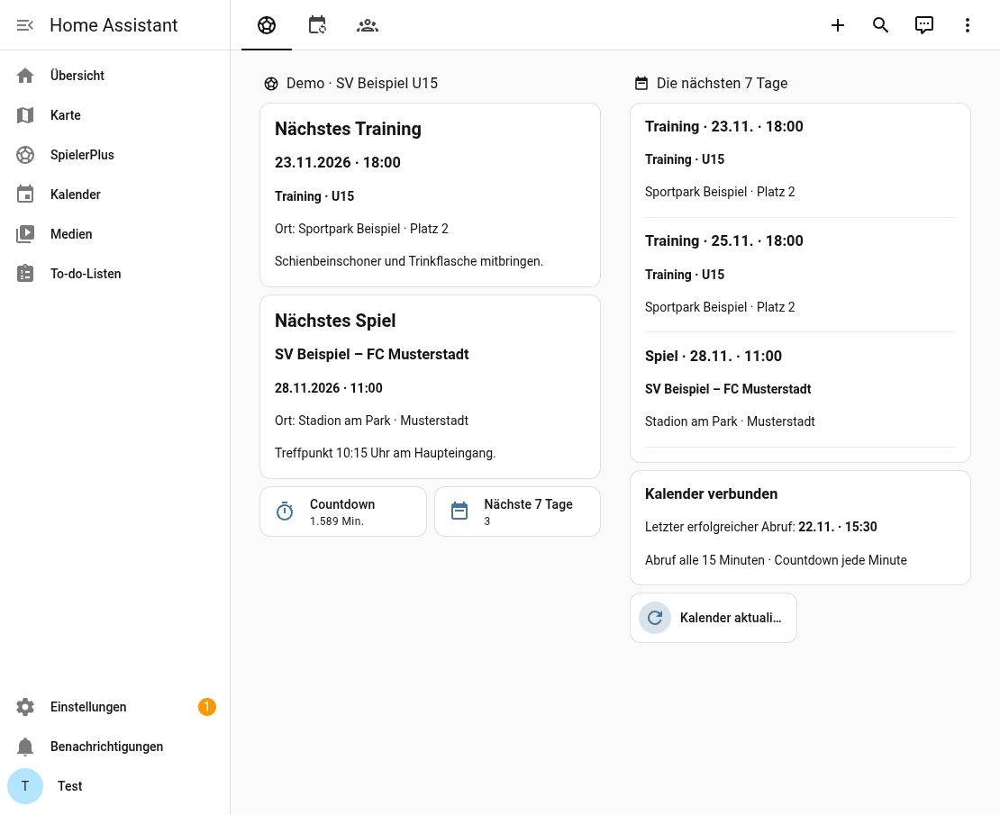
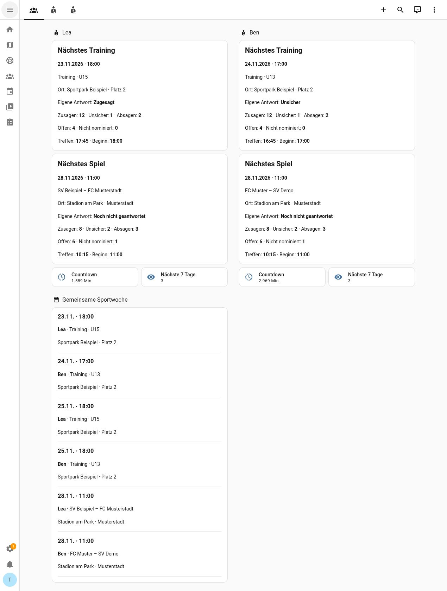
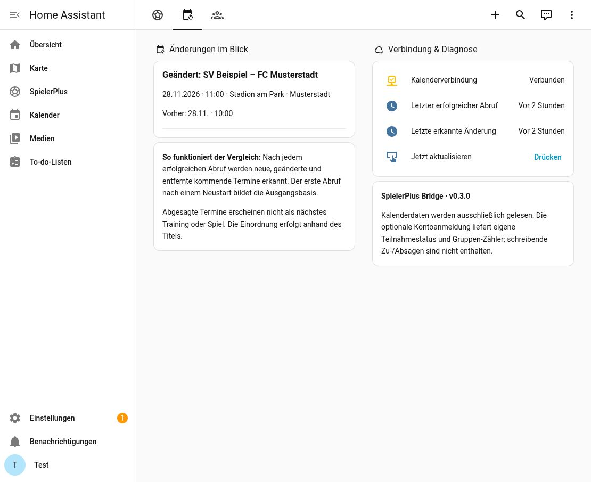
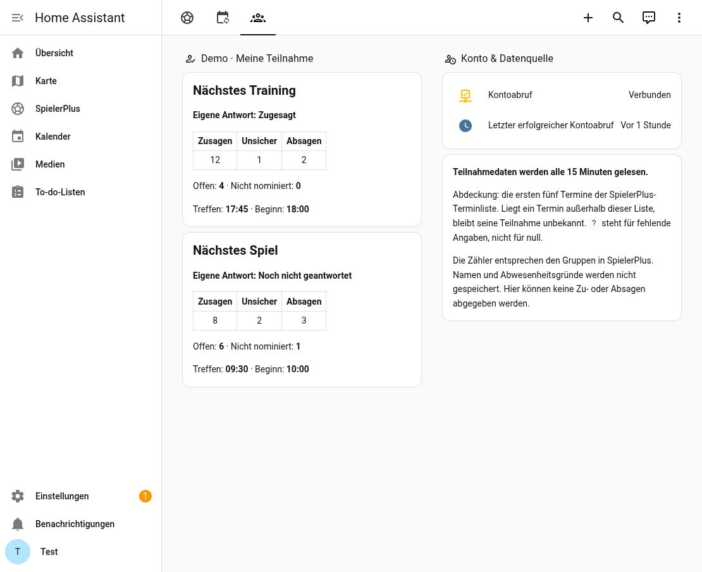
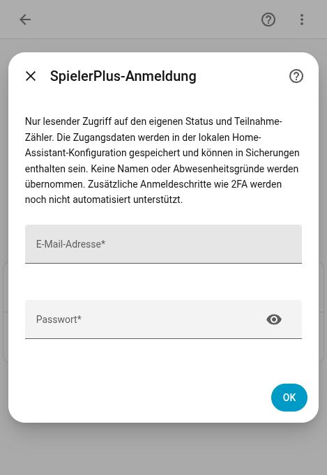

# SpielerPlus Bridge for Home Assistant

[](https://github.com/FabusMingAI/spielerplus-bridge/actions/workflows/ci.yml)
[](https://github.com/hacs/integration)
[](docs/releases/v0.3.0.md)
[](LICENSE)

**English** · [Deutsch](README.de.md)

Your next training, next match and sports week in Home Assistant. **SpielerPlus Bridge** reads your private SpielerPlus calendar subscription and turns it into useful entities for dashboards and automations — with one shared fetch per team.

<p></p>

> **v0.3.0 preview.** Tested on a separate Home Assistant 2026.10.1 instance on Raspberry Pi / aarch64. These screenshots show the included German dashboard with fictional data. No published v0.3.0 release is implied by this preview.

> [!NOTE]
> An independent, unofficial project. It is not affiliated with SpielerPlus. Calendar-only setup uses a private subscription. Optional account sign-in adds read-only attendance data; it never submits an RSVP or changes events.

## What you get

- **Optional attendance:** your own next-training/game response, aggregate group counts and separate meeting/start times, using a privately configured account.

- **Next training and next match** as timestamp sensors, with title, location, description, event link and coordinates when present in the feed.
- **A countdown** to the next upcoming or ongoing event, updated every minute; ongoing events show zero until they end.
- **The next seven days** as a count and event list, across training, matches and other appointments.
- **Change detection:** added, edited and removed upcoming events emit `spielerplus_calendar_changed`. Cancelled events are excluded from upcoming-event sensors and the calendar.
- **Fetch diagnostics:** connection, last successful fetch, last detected change and a refresh button. Event sensors become unavailable if fetching fails; diagnostics remain visible.
- **One subscription, one fetch:** calendar and sensors share a coordinator. Normal polling is every 15 minutes; minute-by-minute countdown updates make no HTTP requests.
- **Multiple teams:** add one integration entry per private subscription.
- **A ready-to-adapt dashboard** using standard Home Assistant cards. No custom frontend dependencies.
- **Optional MCP server:** `list_teams` and `list_events` over local stdio.

Training/match classification uses explicit words in the title, such as `Training`, `Spiel`, `Match` and `Turnier`. Unrecognized titles stay in the calendar and weekly list as other events; classification is not an official SpielerPlus event type.

## Two children, one account

Create one integration entry per child, choosing the matching membership and calendar. **Add service → Another child using an existing account** reuses credentials already stored locally. A discoverable calendar link is used automatically; otherwise enter the selected child's private link directly in Home Assistant.

The [family dashboard](docs/FAMILY.md) places children side by side, combines their sports week chronologically and provides individual child tabs. The `spielerplus.rebuild_dashboard` action creates `spielerplus-family.yaml` using registered entity IDs. Register the dashboard once in Home Assistant; existing files without the management marker are preserved. The generated file contains display names and entity IDs, without credentials.

<p></p>

## Dashboard

The [dashboard template](dashboard/spielerplus.yaml) has **Overview**, **Changes & status** and **Attendance** views. Its text is German; integration setup and entity names are translated into English and German.

<p></p>

Screenshots are from Home Assistant using [fictional fixture entities](docs/screenshots/README.md). The dashboard is installed manually; the integration does not overwrite your dashboards.

## Installation

### HACS custom repository

This project is **not in the HACS default catalogue**.

1. In HACS, open **Custom repositories**, add `https://github.com/FabusMingAI/spielerplus-bridge` and choose **Integration**.
2. Download **SpielerPlus Bridge** and restart Home Assistant.
3. Open **Settings → Devices & services → Add integration → SpielerPlus Calendar**.

For an unreleased preview, use the source branch from its pull request or wait for a published release. The default branch/release may not yet include preview features.

### Manual installation

Copy `custom_components/spielerplus` into `/config/custom_components/spielerplus`, restart Home Assistant and add **SpielerPlus Calendar**.

[](https://my.home-assistant.io/redirect/config_flow_start/?domain=spielerplus)

## Setup

1. In SpielerPlus Premium, open **Termine → Terminliste → Kalender → Kalender abonnieren** and copy the private subscription URL. See the [official instructions](https://support.spielerplus.de/hc/de/articles/6532216018833-Wie-kann-ich-den-SpielerPlus-Kalender-mit-meinem-eigenen-Kalender-synchronisieren).
2. Enter a display name and the private `webcal://www.spielerplus.de/events/ics?...` or equivalent HTTPS URL in the integration. Repeat for additional teams.
3. Home Assistant creates a device, the calendar, six sensors, one connection diagnostic and one refresh button per subscription.
4. Copy [dashboard/spielerplus.yaml](dashboard/spielerplus.yaml) into your config directory. Replace the `spielerplus_demo_*` entity IDs with your own IDs from **Settings → Devices & services → Entities**. Names depend on Home Assistant's language and your calendar name.
5. Register the dashboard in `configuration.yaml` and restart:

```yaml
lovelace:
  dashboards:
    spielerplus-sport:
      mode: yaml
      title: SpielerPlus
      icon: mdi:soccer
      show_in_sidebar: true
      filename: spielerplus.yaml
```

Merge this into an existing `lovelace:` section instead of adding a duplicate key. The dashboard then appears as **SpielerPlus** in the sidebar. The standard Calendar dashboard remains available too.

## Entities per subscription

Entity IDs are generated from the calendar name and Home Assistant's language. The stable suffixes below refer to integration unique IDs, not fixed entity IDs.

| Entity | Purpose |
|---|---|
| Calendar | Upcoming events with time, location and description; the previous calendar unique ID is preserved on update |
| `next_training` | Start of the next ongoing/upcoming training; event details as attributes |
| `next_game` | Start of the next ongoing/upcoming game or tournament |
| `countdown` | Minutes until the next event of any type, including other appointments |
| `events_week` | Ongoing/upcoming events starting within the next rolling seven days; list in `events` |
| `last_success` | Last successful calendar fetch, cached-event count and sanitized error class |
| `last_change` | Last detected change and up to ten changes from that comparison |
| `connection` | Whether the most recent fetch succeeded |
| `refresh` | Fetch the subscription now |

`last_change` is unknown until a change is detected. The comparison baseline is held in memory: the first successful fetch after a restart/reload is quiet, and previous change history is not restored. A successful fetch is required for initial setup.

## Automations

[automation-examples.yaml](dashboard/automation-examples.yaml) includes a local Home Assistant notification for calendar changes and a reminder 60 minutes before an event. These are examples, not automatically enabled notifications. Edit their entity IDs before use.

Change events include `entry_id`, `change` (`added`, `updated`, `removed`), `uid`, `before` and `after`. Details include start/end, title, location, description and status. Treat **removed** as “no longer in the feed”, not proof that the team cancelled it. `STATUS:CANCELLED` is a separate source status.

Changes are detected on successful polling, not pushed immediately by SpielerPlus. Expired events and events merely entering the rolling fetch horizon do not generate removal/addition notifications. The cache covers yesterday through the next 366 days.

## Optional attendance account

Open the configured integration → **Configure → Connect SpielerPlus account**. Enter your email/password only in the local HA dialog, then select the membership belonging to the calendar. Four optional entities are added: next-training attendance, next-game attendance, last successful account fetch and account connection. They expose your own response, counts for accepted/uncertain/declined/pending/not nominated, plus meeting/start/end times when provided.

<p> </p>

Credentials are stored in local HA configuration and can appear in backups. Session cookies stay in memory. Member names and absence reasons are not retained in entities. Account errors do not invalidate successful calendar fetches. **Remove account sign-in** clears active account options and closes the session; backups are separate.

Coverage is the **first five listed events**, without pagination. Only an exact official event URL joins account data to the calendar; missing/unsupported events remain unavailable. Missing group counts are unknown, not zero. Calendar times remain as supplied by ICS; attendance attributes separately expose meeting and actual start times. Counts include whatever roles SpielerPlus puts in each group.

This is an unofficial HTML adapter, not a supported public API. Additional login challenges (2FA/CAPTCHA) are not automated; do not disable account protections. Confirmed authentication failures suspend automatic login retries until reconfiguration. [Details and validation](docs/releases/v0.3.0.md).

## MCP (optional)

Requires Python 3.11+:

```bash
python3 -m venv .venv
. .venv/bin/activate
pip install -r spielerplus_mcp/requirements.txt
python -m spielerplus_mcp.server
```

Provide `SPIELERPLUS_CALENDARS` privately through your MCP host environment as a JSON object mapping display names to private URLs. Optional `SPIELERPLUS_TIMEZONE` defaults to `Europe/Berlin`. Without configured feeds the tools return empty lists.

This is a **local stdio server**, not an authenticated remote MCP service. Installing it does not connect ChatGPT automatically; a supported host or a separately implemented authenticated gateway is needed.

## Privacy and limits

- The subscription URL grants calendar access. Home Assistant stores it in its local configuration; do not put it in screenshots, issues, Git or diagnostic exports. See [SECURITY.md](SECURITY.md).
- Downloads accept only the official HTTPS ICS endpoint, disable redirects and enforce a cumulative 5 MB limit. HTTP request INFO logging is suppressed by the MCP server.
- Coordinates, descriptions and ordinary event links depend on what the feed contains. Event links are filtered so subscription URLs are not exposed as entity links.
- Optional attendance is read-only and aggregate-only. RSVP changes, chat, lineups, member-name lists and event editing are not implemented. See [access and coverage notes](docs/ATTENDANCE.md).
- No paid external routing service, phone notifications or production deployment is configured by installing this integration.

## Development and releases

See [CONTRIBUTING.md](CONTRIBUTING.md), the [changelog](CHANGELOG.md), [v0.3.0 release notes](docs/releases/v0.3.0.md) and [roadmap](ROADMAP.md). Issues and pull requests are welcome; use fictional examples and remove private URLs.

## License

[MIT](LICENSE)
