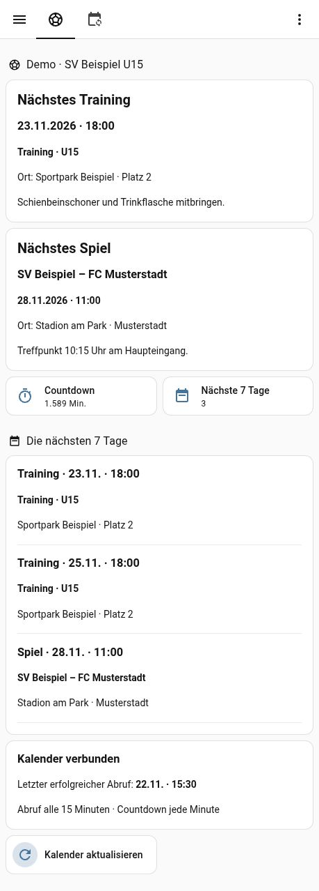

# v0.2.0 — Your sports week / Deine Sportwoche

**Preview · Vorschau · 2026-11-22**

## Deutsch

Aus dem Kalender wird eine Sportübersicht: nächstes Training, nächstes Spiel, Countdown und die kommenden sieben Tage. Kalender und Sensoren teilen sich einen Abruf. Status und letzter erfolgreicher Abruf zeigen, ob die Daten aktuell geladen werden.

**Neu:** sechs Sensoren, Verbindungsdiagnose, Aktualisieren-Button, Gerätezuordnung, DE/EN-Übersetzungen, Erkennung neuer/geänderter/entfernter kommender Termine und eine Dashboard-Vorlage mit Standardkarten.

**Behoben:** Die Integration liest gestreamte ICS-Antworten vollständig und prüft dabei die gesamte Downloadgröße. HTTPX-Request-Info-Logs im MCP-Server werden unterdrückt, damit sie private URLs nicht ausgeben.

**Update von 0.1.0:** Integrationsordner ersetzen, Home Assistant neu starten. Die bisherige Kalender-Unique-ID bleibt erhalten. Die neuen Entitäten werden ergänzt. Die Dashboard-Vorlage separat einrichten; bestehende Dashboards bleiben erhalten. Für die Ersteinrichtung bzw. das Laden nach Neustart ist ein erfolgreicher Kalenderabruf erforderlich.

**Grenzen:** nur lesend; keine Teilnehmerlisten oder Zu-/Absagen. Änderungsvergleich ab dem ersten erfolgreichen Abruf nach jedem Neustart/Neuladen; keine dauerhafte Änderungshistorie und keine automatisch aktivierten Handybenachrichtigungen. Nicht erkannte Termintitel bleiben sonstige Termine. Der lokale MCP-Server ist noch kein Remote-ChatGPT-Anschluss.

## English

The calendar becomes a sports overview: next training, next game, countdown and the next seven days. One shared fetch supplies the calendar and sensors; connection and last-success diagnostics show whether the source is responding.

**Added:** six sensors, connection diagnostic, refresh button, device grouping, DE/EN translations, change events for added/edited/removed upcoming appointments and a dashboard template using standard cards.

**Fixed:** complete streamed ICS downloads with a cumulative size limit. Suppressed HTTPX request INFO logs in the MCP server to avoid printing private URLs.

**Upgrade from 0.1.0:** replace the integration folder and restart Home Assistant. The existing calendar unique ID is preserved and new entities are added. Register the dashboard template separately; existing dashboards are not overwritten. Loading after restart requires a successful calendar fetch.

**Limits:** read-only; no attendance or RSVP support. Changes are compared from the first successful fetch after every restart/reload; history is not persisted and phone notifications are not automatically enabled. Unrecognized titles remain other appointments. Local MCP stdio is not a remote ChatGPT connection.

## Validation / Prüfung

- Python parser/security/metadata/change tests: see CI and the pull request's recorded results.
- Additional coordinator/entity tests: `tests_ha/test_runtime.py`, executed inside Home Assistant.
- Live calendar and dashboard smoke checks on a separate Home Assistant 2026.10.1 / aarch64 test instance.
- Public screenshots use fictional data; no credentials or personal calendar exports are included.

A release tag and public GitHub Release must be created separately after review. These notes do not claim HACS-default inclusion or a Home Assistant quality-scale certification.
