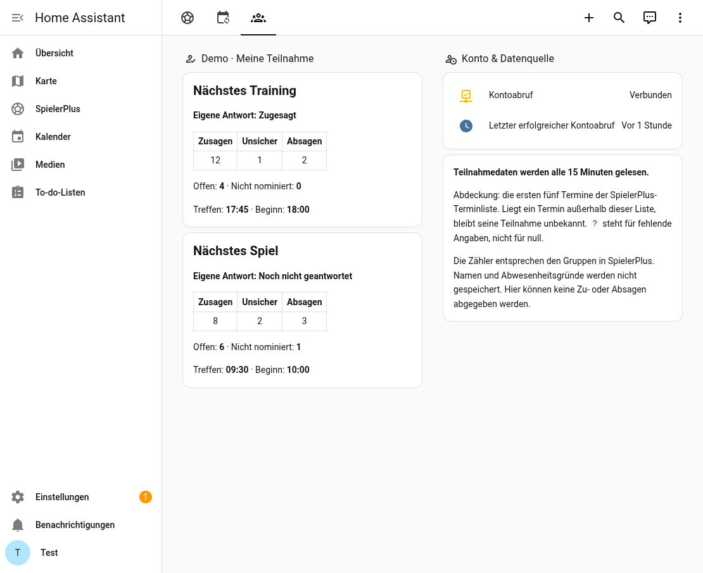
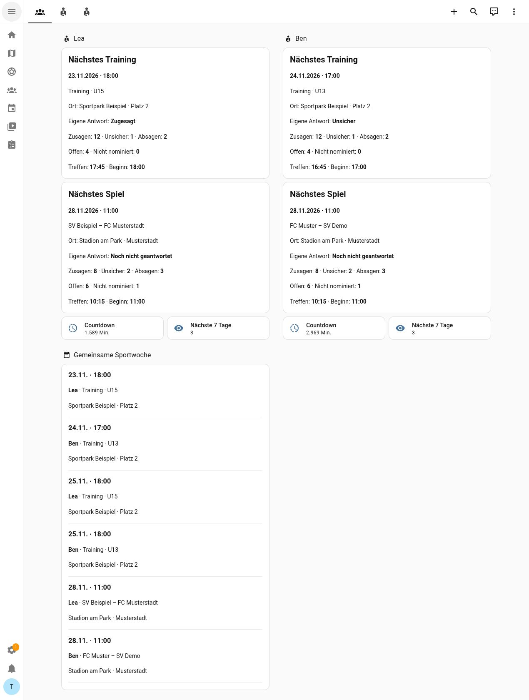

# v0.3.0 — Read-only attendance / Teilnahme lesen

**Preview · Vorschau · 2026-11-22**

## Deutsch

Die Kalenderintegration kann optional eine eigene SpielerPlus-Anmeldung verwenden. Neu sind der eigene Teilnahmestatus für das nächste Training und Spiel, die zugehörigen Gruppen-Zähler sowie getrennte Treff- und Beginnzeiten. Kontoabruf und Kalenderabruf haben getrennte Diagnosen: Ein Fehler bei der Kontoabfrage lässt einen erfolgreichen ICS-Abruf weiter verfügbar.

**Einrichtung:** Bestehende Integration öffnen → **Konfigurieren → SpielerPlus-Konto verbinden**, E-Mail und Passwort ausschließlich in Home Assistant eingeben und die zum Kalender passende Mitgliedschaft auswählen. Die Anmeldung bleibt freiwillig. **Kontoanmeldung entfernen** entfernt sie aus der aktiven Konfiguration und beendet die private Sitzung; vorhandene Backups werden dadurch nicht bereinigt.

**Datenschutz:** Die Zugangsdaten liegen in der lokalen HA-Konfiguration und können in Backups enthalten sein. Session-Cookies bleiben im Speicher. Die Entitäten übernehmen keine Teilnehmernamen oder Abwesenheitsgründe. Es gibt keinen schreibenden Zu-/Absage-Endpunkt im Client.

**Abdeckung:** Die ersten fünf Termine der SpielerPlus-Terminliste, derzeit ohne Nachladen weiterer Seiten. Kalender und Kontodaten werden anhand der offiziellen Termin-URL verbunden, nicht anhand eines ähnlichen Titels oder Datums. Fehlende Gruppenwerte bleiben unbekannt; null ist ein tatsächlich gemeldeter Zähler. Die Zähler umfassen die von SpielerPlus angezeigten Gruppen, nicht zwingend nur Spieler. Das Kalender-DTSTART bleibt unverändert; Kontoattribute unterscheiden Treffzeit und Beginn.

**Grenzen:** Webseitenänderungen und Berechtigungen können den Abruf beeinträchtigen. 2FA/CAPTCHA oder andere zusätzliche Sicherheitsabfragen werden nicht automatisiert gelöst; Schutzfunktionen nicht abschalten. Nach eindeutig abgelehnter Anmeldung erfolgen bis zur erneuten Konfiguration keine automatischen weiteren Loginversuche. Direkte Zu-/Absagen, Nachrichten und Namenslisten sind nicht enthalten.

### Familienfunktion

Mehrere Kinder können dieselbe lokal gespeicherte Anmeldung verwenden. Jedes Kind erhält eine eigene Mitgliedschaft, einen Kalender und getrennte Teilnahmedaten. Die neue Familienansicht bietet eine gemeinsame Sportwoche und eigene Kind-Tabs. [Einrichtung und Dateischutz](../FAMILY.md).

## English

Optional SpielerPlus account sign-in adds your own attendance response for the next training/game, aggregate group counts and separate meeting/start times. Account failures are isolated from successful ICS calendar fetches.

**Setup:** Open the existing integration → **Configure → Connect SpielerPlus account**, enter credentials in the local HA UI and choose the membership corresponding to this calendar. Removing the optional sign-in clears active options and closes its private session; it does not remove older backups.

**Privacy:** Credentials are stored in local Home Assistant configuration and may be included in backups. Session cookies stay in memory. No member names or absence reasons are exported to entities. The client implements no RSVP-write endpoint.

**Coverage:** The first five events in the provider's event list, without pagination. Matching uses official event URLs, never title/date guesses. Missing counts stay unknown; zero is an actual reported value. Counts reflect provider groups and are not necessarily player-only. Calendar DTSTART is preserved; account attributes distinguish meeting time from event start.

**Limits:** Website changes and permissions can affect access. Additional authentication challenges such as 2FA/CAPTCHA are not automated; do not disable protections. Confirmed authentication failures stop automatic login retries until reconfiguration. No attendance writes, messaging or member-name lists.

### Family support

Reuse a locally stored login for multiple children, with a separate membership, calendar and attendance context per entry. Generate a family dashboard with a combined sports week and child tabs. [Setup and file protection](../FAMILY.md).

## Validation / Prüfung

- Live read-only inspection of the authenticated event list and participation dialog, followed by successful local HA setup and matching next-training/game responses and aggregate counts.
- 68 parser/security/dashboard tests and 21 HA runtime/transport/config-flow tests (7 calendar, 8 account, 6 family tests).
- Bounded HTML downloads, same-origin redirect checks, a POST endpoint allowlist and password/CSRF-safe error messages.
- Public screenshots use fictional data and empty setup fields.

No production Home Assistant deployment and no release tag are implied by this preview.
